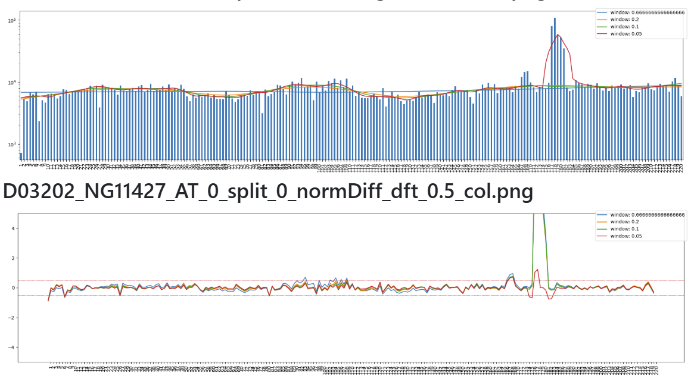
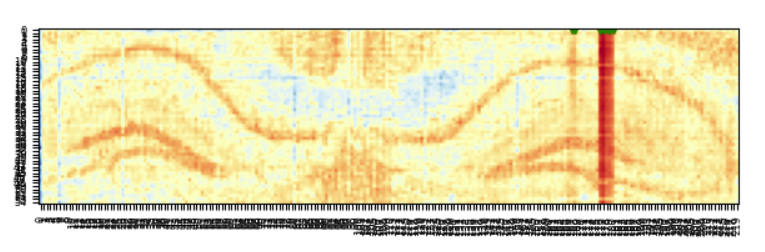
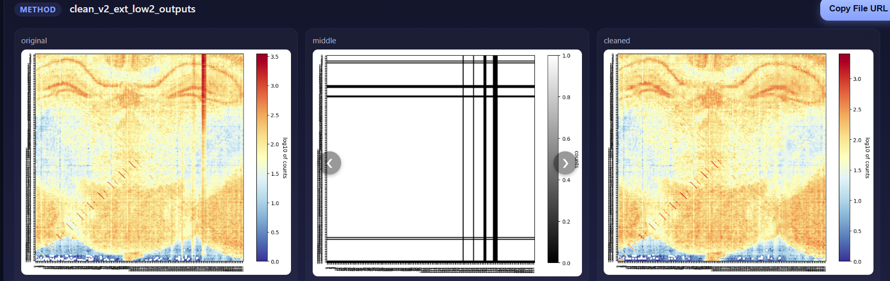
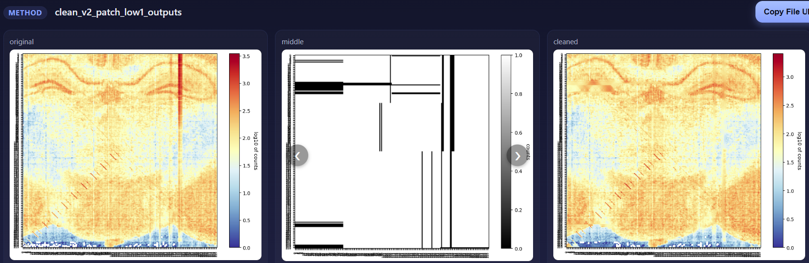

# CLEAN

!!! info "At a glance"
    **Name:** Channel-Linked Efficiency Artifact Normalization ·
    **Input:** FASTQ · **Output:** CLEANed FASTQ for downstream preprocessing

## Overview

CLEAN corrects rows and columns of a spatial array that show abnormally high
signal, which we attribute to increased capture efficiency in those
microfluidic channels. Reads in affected
[tixels](../reference/glossary.md#tixel) are downsampled so their counts match
the surrounding spatial neighborhood, while reads in unaffected tixels are left
untouched.

The result is a CLEANed FASTQ that is used for downstream preprocessing, with
high-signal rows and columns removed and counts comparable to the surrounding
tissue.

CLEAN addresses *intensity* artifacts — some channels capture more efficiently
than others. That is a different problem from
[cross-talk](../reference/glossary.md#cross-talk), which is positional
bleed-through between adjacent channels and is handled by
[cross-talk correction](../reference/glossary.md#cross-talk-correction).

## Steps

### Step 1: Identify affected rows and columns

Outlier columns and rows are flagged by comparing each one's total counts to a
smoothed trend across the array.

1. Reads are assigned to spatial x and y positions based on the barcodes in each
   read.
2. Read counts are summed for each column.
3. Lowess smoothing is applied to the column sums at two different smoothing
   strengths.
4. For each column, the normalized difference is calculated as the difference
   between the actual and smoothed values, divided by the actual value.
5. Any column with a normalized difference outside ±0.5 (an empirically
   determined cutoff) is flagged as an outlier that needs correction.
6. Steps 2–5 are repeated for row sums.

```
normalized difference = (actual − smoothed) / actual
```

Together, the flagged rows and columns define a mask of tixels that require
correction.



*__Figure 1.__ Column sums with lowess fits (top) and the normalized difference
for each column, with the ±0.5 cutoff shown as dashed lines (bottom). A cluster
of high-signal columns exceeds the cutoff.*



*__Figure 2.__ Zoomed view of the spatial map showing a high-signal column.*

### Step 2: Estimate corrected values from the spatial neighborhood

Each masked tixel is assigned a target count based on its unaffected neighbors.

1. For each tixel in the mask, the average count of non-affected tixels in its
   neighborhood is calculated.
2. The neighborhood is expanded until enough unaffected neighbors are
   identified.
3. The ratio of this new value to the tixel's previous value is recorded as its
   downsampling fraction.

### Step 3: Downsample reads and write the CLEANed FASTQ

Correction is applied at the read level, so only affected tixels change.

- Reads from affected tixels are downsampled from the FASTQ in a
  barcode-specific manner, using each tixel's downsampling fraction.
- Reads from unaffected tixels are left untouched.
- The CLEANed FASTQ is then used for downstream preprocessing. It no longer
  contains high-signal rows and columns, and counts in corrected tixels are
  comparable to their surrounding spatial neighborhood.

## Regional approach for partial artifacts

Some artifacts occur in only a portion of a column or row. Whole-array sums can
then over-correct tixels that are otherwise fine, simply because their column or
row is affected in another region of the array.

To address this, a second approach divides the array into regions of 1/4 by 1/4
of the tixels (1/16 of the total array). Row and column sums are calculated
within each region, and the same detection and correction steps described above
are applied.

## Example results

Both approaches remove the high-signal rows and columns from the original data.
Each panel shows the original counts (left), the correction mask (middle,
black = tixels flagged for correction), and the CLEANed counts (right), on a
log10 scale.

### Whole-array approach

The mask spans complete rows and columns.



*__Figure 3.__ Whole-array approach: original (left), mask (middle), and
CLEANed (right).*

### Regional approach

The mask covers only the portions of rows and columns where the artifact occurs.



*__Figure 4.__ Regional approach: original (left), mask (middle), and
CLEANed (right).*

## Where CLEAN runs

In the ATX pipeline the two halves of CLEAN are performed by different
components:

| Stage | Where it happens |
|---|---|
| **Detection** — flag affected rows/columns, compute each tixel's downsampling fraction | [BarcodeQC](barcodeqc.md), which writes the correction table (`<sample>_cleanTable.csv`, columns `mer` and `finalDownFract`). |
| **Correction** — downsample reads and emit the CLEANed FASTQ | [Epigenomic preprocessing](../epigenomics/preprocessing.md) / [RNAQC](../transcriptome/rnaqc.md), which take that table as `ds_table` and enable it with the `cleaning` toggle. |

Running BarcodeQC **before** preprocessing is therefore what makes CLEAN
available to a run.
